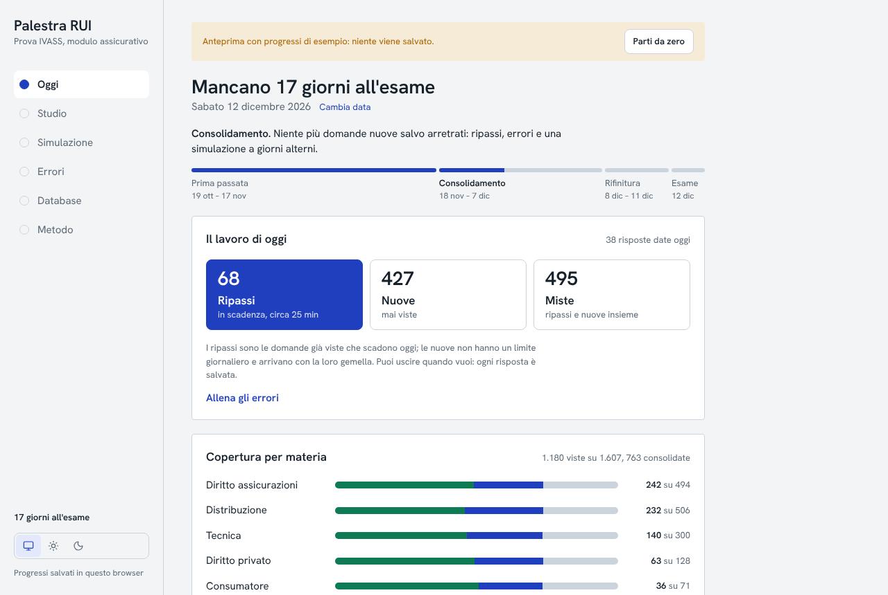

# Palestra RUI

Web app gratuita per allenarsi alla prova di idoneità IVASS per intermediari assicurativi (iscrizione al RUI sezione A/B), modulo assicurativo.



**Demo:** https://lorenzo-alessandri.github.io/Palestra-Rui/

## Cosa fa

- **Tutte le 1.758 domande** del database ufficiale IVASS del modulo assicurativo, ridotte a **1.607 schede**: i 131 gruppi di domande identiche presenti nel PDF ufficiale sono stati uniti, così una domanda già vista non torna come "nuova".
- **Domande gemelle**: 358 domande che differiscono per un solo termine chiave (per esempio ramo V e ramo VI) restano separate ma vengono mostrate insieme dopo ogni risposta.
- **Studio con ripetizione dilazionata** (Leitner a 5 livelli): ripassi, domande nuove e sessioni miste; i ripassi in scadenza vengono prima delle nuove.
- **Simulazione d'esame**: 50 quesiti in 75 minuti, punteggio ufficiale (+1 corretta, 0 non data, −0,5 errata; idoneità a 60/100), con revisione completa e archivio delle prove.
- **Errori, Database e Metodo**: allenamento sugli errori, ricerca nel database con filtri, metodo di studio.
- **Data d'esame facoltativa**: con la data compaiono conto alla rovescia e fasi di studio.
- Progressi salvati solo nel browser (`localStorage`), con esportazione e importazione in `.json`. Tema chiaro, scuro o automatico; funziona da computer e da telefono.

## Come l'ho costruita

Ho usato Palestra RUI per preparare la mia prova IVASS. Il codice è stato scritto con un assistente AI (Claude); il mio lavoro è stato quello di un analista funzionale:

- **Requisiti**: ho definito cosa doveva fare l'app e le regole d'esame da rispettare (50 domande, punteggio ufficiale, soglia di idoneità).
- **Analisi dei dati**: durante lo studio è emerso che domande già viste tornavano come nuove. Il controllo ha mostrato 131 gruppi di domande identiche nel database ufficiale; ho deciso di unirli e di collegare invece, senza unirle, le 358 domande "gemelle". L'estrazione dal PDF IVASS è stata verificata con due programmi di lettura diversi.
- **Decisioni di prodotto**: progressi salvati solo nel browser (nessun account, nessun dato raccolto), data d'esame scelta dall'utente per valere in ogni sessione, uso solo didattico come richiede la licenza IVASS.
- **Test**: ho provato l'app a ogni passaggio e chiesto correzioni, per esempio la sostituzione di una mappa con 1.607 caselle, poco leggibile, con barre di avanzamento per materia.

## Tecnologie

React, TypeScript, Tailwind CSS, Vite. Nessun backend: è un sito statico.

## Avvio in locale

Serve Node.js 20 o successivo.

```bash
npm install
npm run dev
```

Poi apri l'indirizzo che compare nel terminale (di solito http://localhost:5173).

## Build e pubblicazione

```bash
npm run build          # sito statico in dist/
npm run build:single   # un unico file HTML in dist-single/ (anteprima con dati di esempio)
```

Ogni modifica sul branch `main` viene compilata e pubblicata su GitHub Pages da `.github/workflows/deploy.yml`.

## Struttura

```
src/
  data/    domande e legami tra domande (doppioni e gemelle)
  core/    logica pura: date, fasi, Leitner, ricerca, import/export
  store/   stato dell'app, sessione di studio, simulazione
  ui/      componenti grafici
  views/   le sei schermate
  shell/   navigazione
```

I progressi usano la chiave `palestra-rui-v1` (simulazione in corso: `palestra-rui-sim`), compatibile con le esportazioni della versione precedente.

## Fonte dei quesiti e licenza

IVASS, «Database dei quesiti per le prove RUI», dicembre 2025, predisposto con i Dipartimenti di Scienze giuridiche e di Scienze per l'economia e l'impresa dell'Università di Firenze. Riproduzione consentita a fini didattici e non commerciali con citazione della fonte. Formato della prova e database possono cambiare da un'edizione all'altra: controlla sempre il bando della tua sessione sul sito IVASS.

Il codice dell'applicazione è sotto licenza MIT (vedi `LICENSE`); il contenuto dei quesiti resta dell'IVASS.
